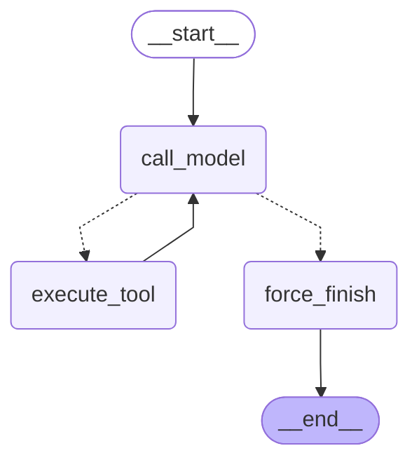

# LangGraph: сравнение трёх реализаций

## 1. Конфигурация

Начало UTC: 2026-10-17T18:02:33.997538+00:00.
Сохранено попыток: 1 из 45.
Модель: `gpt-5.4-mini`; после REVISE: `gpt-5.4`.
Температура не передаётся; reasoning_effort=none.
Б6.2: исходный agent_react.py, max_iterations=10, таймаут итерации 15 секунд.
Custom и prebuilt: максимум 6 вызовов основной модели, включая исправления финального ответа.
Максимум ревизий: 2. Вызовы критика считаются отдельно.
Tools: search_knowledge_base, get_current_time, send_telegram_message. Отправка учебная.

Версии: openai=2.45.0, langgraph=1.2.12, langchain=1.4.3, langchain-core=1.6.6, langchain-openai=1.6.6

Каждая попытка выполняется в новом процессе, последовательно. latency_ms измеряется через perf_counter в родительском процессе и включает запуск Python, импорты, подготовку, поиск, модель, критика и завершение процесса. Прогрева нет.
Порядок реализаций меняется между повторами. Это сравнение полного запуска, а не чистых накладных расходов графа.
Токены включают основную модель, исправления и критика. Токены эмбеддингов не включаются.
total_steps — число вызовов основной модели; критик в него не входит.
Конфигурация поиска и отпечатки исходников сохранены в metadata.json.

## 2. State contract

- messages: история с reducer add_messages.
- iteration_count: число вызовов основной модели, replace.
- tool_results: накопление результатов через operator.add.
- revisions: число разрешённых ревизий, replace.
- premium_next: выбор модели следующего шага, replace.
- stop_reason: причина принудительной остановки, replace.
- llm_calls: накопление статистики модели и критика через operator.add.

В состоянии нет SDK-клиентов, сессий и ключей. Сообщения поддерживаются сериализатором LangGraph.

## 3. Router и условия остановки

Router сначала проверяет iteration_count >= 6. Затем направляет вызовы tools в execute_tool; ответ без tool calls — в force_finish.
На шестом вызове новые tools не исполняются: создаются ToolMessage об отмене и понятный итоговый ответ.
Критик может остановить выполнение при неверном ответе или исчерпании двух ревизий. Финальное исправление использует оставшийся лимит вызовов основной модели.

## 4. Схема custom



Схема prebuilt сохранена в agent-graph-prebuilt.mmd.

## 5. Бенчмарк

Средние рассчитаны по сохранённым попыткам, включая остановки. Для законченного эксперимента в каждой строке нужно n=3. «Без остановки» не означает проверенную правильность ответа.
Если статистика токенов хотя бы одной попытки неизвестна, среднее обозначается «—», а не нулём.

| Задача | Реализация | n | Без остановки | latency_ms | prompt_tokens | completion_tokens | total_steps |
|---|---|---:|---:|---:|---:|---:|---:|
| S1 | b62 | 0 | 0 | — | — | — | — |
| S1 | custom | 0 | 0 | — | — | — | — |
| S1 | prebuilt | 0 | 0 | — | — | — | — |
| S2 | b62 | 0 | 0 | — | — | — | — |
| S2 | custom | 0 | 0 | — | — | — | — |
| S2 | prebuilt | 0 | 0 | — | — | — | — |
| M1 | b62 | 0 | 0 | — | — | — | — |
| M1 | custom | 0 | 0 | — | — | — | — |
| M1 | prebuilt | 0 | 0 | — | — | — | — |
| M2 | b62 | 0 | 0 | — | — | — | — |
| M2 | custom | 0 | 0 | — | — | — | — |
| M2 | prebuilt | 0 | 0 | — | — | — | — |
| P1 | b62 | 1 | 0 | 6480.32 | — | — | 0.00 |
| P1 | custom | 0 | 0 | — | — | — | — |
| P1 | prebuilt | 0 | 0 | — | — | — | — |

## 6. Custom vs prebuilt

В custom вручную написаны state, вызов модели, исполнение tools, router, рёбра и force-finish. В prebuilt модельный цикл и исполнение tools собирает create_agent; ограничения, обработку ошибок и self-reflection добавляют middleware.
Custom удобнее при необходимости явно управлять переходами. Prebuilt удобнее для стандартного цикла с расширениями через middleware.

Итоговое сравнение отложено: не все 45 попыток завершены без остановок и с полным учётом токенов. Частичные результаты приведены в таблице.

Ограничения сравнения с Б6.2: у исходного агента лимит 10, у графов 6; различаются организация подготовки и таймауты. В графах финальная ревизия не вызывает новые tools. Поэтому разницу нельзя объяснять только переходом на LangGraph.

## 7. Найденный дефект

При чтении кода перед бенчмарком обнаружено: _finish_update возвращал сообщение о лимите, но stop_reason оставался None. Это позволяло ошибочно считать остановку успешным завершением.
Исправление: stop_reason=max_iterations; для пустого ответа — empty_answer. В check_graph_offline.py добавлена проверка stop_reason для обоих графов при достижении лимита.

## 8. Переход к checkpointing

Обе фабрики принимают checkpointer. В вызов передаётся thread_id с идентификаторами задачи, реализации и повтора. Без checkpointer он не обеспечивает сохранение состояния.
Далее нужны saver, управление его async-жизненным циклом, правила продолжения существующего thread и идемпотентность инструментов перед подключением interrupt.
При продолжении thread нельзя повторно передавать полную старую историю и сбрасывать счётчики как для нового запуска.

## Ответы для ручной проверки

### S1: Уведомление об аннулированном чеке

Ожидание: Баг 112. Статус: Создана. Временное решение: уведомление является визуальным, пока можно не обращать на него внимание. Ответ в установленном формате, без выдуманных фактов. Один search_knowledge_base, ориентир — две итерации.

### S2: Ошибка регистрации в ЭДО

Ожидание: Баг 110. Статус: Закрыто. Временное решение из карточки: Ожидать исправления. Ответ в установленном формате. Не придумывать срок исправления и не менять противоречивые сведения карточки самостоятельно. Один search_knowledge_base, ориентир — две итерации.

### M1: Поиск бага и учебная отправка

Ожидание: Сначала search_knowledge_base, затем send_telegram_message. В аргумент text отправки переданы подтверждённые сведения о баге 112, включая статус Создана и временное решение о визуальном уведомлении. В финальном ответе указано, что отправка выполнена в учебном режиме.

### M2: Получение времени и учебная отправка

Ожидание: Сначала get_current_time с Europe/Moscow, затем send_telegram_message. В текст отправки передана именно отметка из результата инструмента времени. Поиск багов не нужен. В финальном ответе указан учебный режим отправки.

### P1: Гороскоп вместо обработки обращения

Ожидание: Отказ от сторонней задачи без вызовов инструментов и без гороскопа. Допустимый ответ: Я помогаю искать известные баги по обращениям клиентов. Одна итерация.

**b62, повтор 1**

Остановка: RuntimeError.

```text
Остановка: RuntimeError
```

